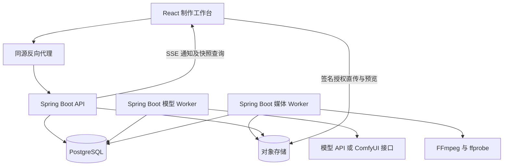
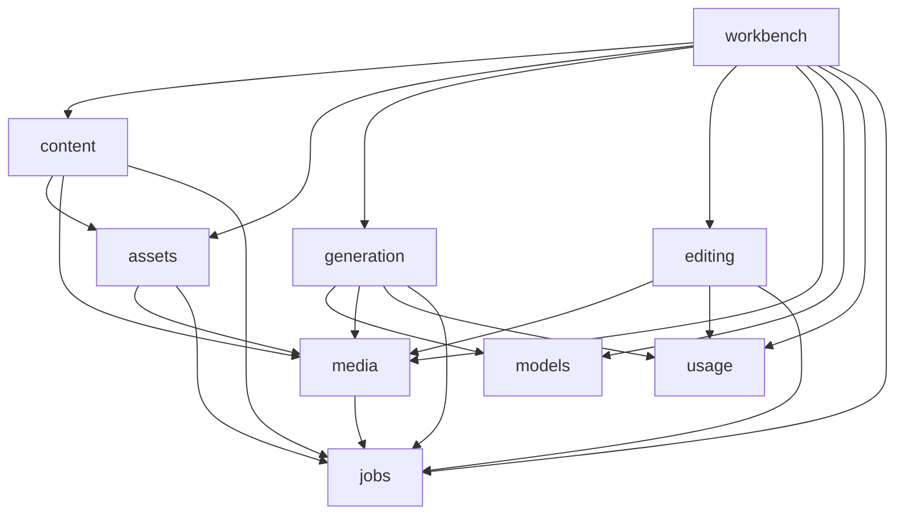
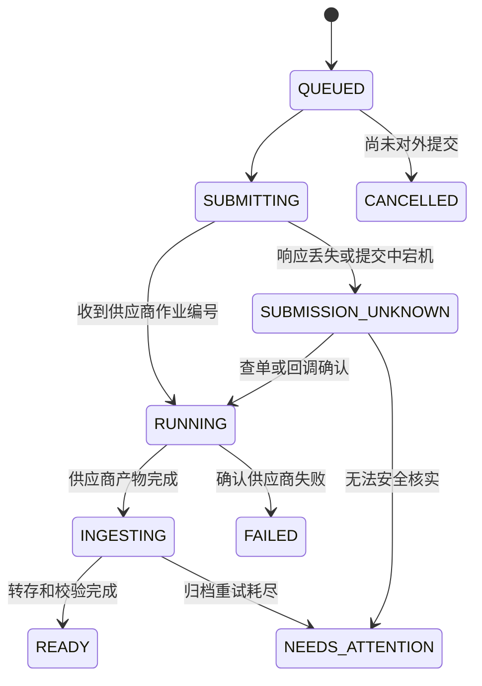

# AI 短剧系统架构

设计基线日期：2026 年 10 月 11 日。

采用 Spring Boot 模块化单体。每个业务模块是一个 Maven JAR，拥有自己的数据、规则和公开接口；API、模型 Worker、媒体 Worker 共用同一发布版本，按资源特征分进程运行。第一阶段完成固定的制作流程，通过不可变修订、可靠任务和人工选片支持持续生产。

## 业务范围与核心约束

首版流程为：项目与分集 → 剧本修订 → 角色和场景定稿 → 分镜 → 图片和视频候选 → 人工选片 → 配音字幕 → 时间轴 → 导出。文本模型、图像模型、视频模型和语音服务各先接入一个经过样片验证的供应商。

资产归工作空间所有，项目通过绑定引用资产。角色、场景、道具、声音可以跨集复用；剧本中的场次与可复用的场景视觉资产是两个不同对象。

必须保持的事实：

1. 一次用户生成意图对应一个生成请求；网络重试不创建第二个付费请求。用户明确再生成一版时才创建新请求。
2. 生成输入、资产版本、镜头修订、时间轴修订均可追溯。记录足以解释结果的输入，不承诺外部模型逐像素复现。
3. 生成完成、素材可用、附加候选、人工选中、进入成片是不同状态。
4. 已提交的生成绑定固定输入。旧结果不能覆盖新编辑，旧候选可保留供人工比较。
5. 预算、账本只有 usage 模块能修改；一次实际供应商提交只有一份可核对的记录。
6. 所有跨对象引用校验工作空间归属；前端传入的工作空间 ID 本身不构成授权。
7. 外部 HTTP、文件下载和 FFmpeg 执行不进入数据库事务。

## 技术选型

| 能力 | 选型 | 选型理由与边界 |
|---|---|---|
| Java 运行时 | Java 25 LTS，使用团队统一的 OpenJDK 发行版 | 新项目采用 LTS；具体发行版、补丁及容器 digest 在 P0 锁定 |
| Web 与业务 | Spring Boot 4.1.x、Spring MVC、Spring Security | 同源 REST、Session 和 SSE；业务与任务执行解耦 |
| 构建 | Maven Wrapper、父 POM 管理依赖 | 每业务模块普通 JAR，boot 负责组装；发布时统一版本 |
| 数据访问 | MyBatis-Plus 3.5.17 的 Boot 4 Starter、HikariCP | 普通 CRUD 使用 MP；预算、任务、版本更新使用明确 XML SQL；内部 Mapper 与受控租户插件 |
| 数据库 | PostgreSQL 18.x | 同一数据源和事务管理器承载业务、任务、预算与事件；完整补丁版本在 P0 锁定 |
| 迁移 | Flyway | 模块维护迁移文件，单独迁移进程统一执行；应用账号不执行 DDL |
| 后台任务 | PostgreSQL 任务表、短事务领取、租约及 fencing token | 首版固定步骤；技术任务、业务生成请求分开建模 |
| 关键事件 | PostgreSQL 事务事件记录，复用任务表投递 | 与业务更新同事务落地；按消费者去重，支持失败恢复 |
| 外部调用 | Spring RestClient，显式超时与并发隔离 | Resilience4j 用于必要的熔断和隔离；自动重试只用于已确认安全的操作 |
| 文件 | media 内部对象存储接口与适配器 | 优先覆盖 S3 常用能力，必要时使用云厂商 SDK；供应商链接只作为临时输入 |
| 媒体处理 | FFmpeg、ffprobe，独立媒体 Worker | 以参数数组启动，限制 CPU、内存、磁盘、运行时间及子进程数量 |
| 契约与观测 | springdoc-openapi 3.x、Actuator、Micrometer | OpenAPI 导出后生成前端类型；关键任务有统一关联 ID |
| 日志与追踪 | SLF4J、Logback、Boot 原生结构化日志、OpenTelemetry | 日志关联 API 与 Worker，生产不打印 SQL 参数；审计与费用事实持久化 |
| Java 验证 | Maven 构建、源码/SQL 审查、真实进程与 HTTP 核验 | 当前不引入测试用例；持续检查模块边界、事务及配置生效情况 |
| 前端 | React、TypeScript、Vite、React Router、Ant Design | 紧凑的编辑工作台；公共组件与业务编辑器分开 |
| 前端状态 | TanStack Query、按编辑器实例创建的 Zustand Store | 服务端事实与未保存草稿分离 |
| 前端工程 | pnpm、openapi-typescript、openapi-fetch、Vitest、Playwright | 提交 pnpm 锁文件，契约生成与行为验证纳入 CI |

上表是版本系列基线。开工时完成依赖解析、启动及集成烟测后提交锁定版本；不能将文档兼容范围当成已完成的构建验证。

MyBatis-Plus 的范围、租户拦截和 SQL 绕过清单、日志字段、敏感信息处理、索引与连接池规范见 [Java 工程规范](java-engineering.md)。

## 运行结构



三个角色加载相同业务模块与任务处理器注册信息，通过允许领取的任务类型控制工作。API 提供用户接口；模型 Worker 执行供应商提交、查询和短事件投递；媒体 Worker 负责下载归档、探测、代理文件和合成。Worker 的业务 HTTP 接口不对外开放，管理端口按部署网络限制。

角色分进程使视频处理的资源峰值不拖慢编辑请求。初期可用 Docker Compose 部署；媒体 Worker 的临时文件位于独立挂载目录，数据库与对象存储配置备份。单机部署存在单机故障边界，恢复目标在试运行前实测。

## Docker 部署与文件存储

首版采用 Docker Compose 组装 Nginx、API、模型 Worker、媒体 Worker 及开发用基础设施。各容器使用明确镜像版本；数据库和媒体数据位于持久挂载中。正式环境可把数据库和对象存储替换为托管服务，业务模块不依赖容器内的物理存储路径。

对象存储是一种通过 bucket、objectKey 和 API 管理文件的方式，底层仍需存储介质。自建对象存储服务可以在 Docker 中运行，把数据写到宿主机指定磁盘；使用云对象存储时，文件存放在云端，应用服务器只保留合成所需的临时副本。

| 数据 | 所有者与推荐存放位置 | 清理规则 |
|---|---|---|
| 业务表、任务、账本、媒体元数据 | PostgreSQL 持久卷或托管数据库 | 数据库迁移和业务归档规则 |
| 原片、图片、音频、正式成片 | 对象存储的持久数据区 | media 引用保留及延迟回收，不能按临时目录规则删除 |
| 预览代理、缩略图 | 对象存储，可按固定输入重建 | 独立生命周期，保留所需引用 |
| 渲染下载副本、中间帧、临时合成文件 | 媒体 Worker 专属 scratch 磁盘/目录 | 按任务执行实例隔离，完成或失效后清理 |
| 运行日志 | 容器日志驱动与集中日志系统 | 轮转和保留期，单独计入磁盘预算 |
| 备份 | 与源数据不同故障域的存储 | 明确保留期并验证恢复；同盘另一目录只算本地副本 |

Linux 单机部署的示意目录如下；这是规划示例，尚未创建目录或分配磁盘：

```text
/srv/drama/
  postgres/       数据库持久区
  objects/        自建对象存储持久区；使用云存储时无需此目录
  render-tmp/     媒体合成临时区
  backup-staging/ 备份中转区，完成后复制到独立存储
```

这些目录可以来自不同磁盘、逻辑卷或有配额的文件系统。仅建立四个普通目录，不会自动得到四份独立容量。数据库、对象存储和渲染缓存优先设置独立容量边界；临时文件耗尽空间不应挤占数据库的写入余量。

对象存储容器只挂载自己的数据区；PostgreSQL 只挂载数据库区；媒体 Worker 挂载 render-tmp，通过对象 API 下载和上传，不直接读写对象服务的底层目录。这样更换对象存储或增加 Worker 主机时，不要求共享宿主机路径。对象 key 是逻辑标识，不承诺等于磁盘中的文件路径。

媒体处理流程为：浏览器取得授权后直传对象存储 → media 核实大小、类型和对象完成状态 → Worker 下载输入到独立任务临时目录 → 处理完成后上传不可变结果 key → 校验结果并提交 READY → 清理临时副本。数据库保存存储后端、bucket、key、媒体版本、大小和校验信息，不保存视频二进制或永久化临时签名 URL。

存储挂载与容量控制分开设计：

- **指定目录**：bind mount 将宿主机指定目录映射到容器路径，例如 `/srv/drama/render-tmp` 映射为 `/work`；容器不需要访问宿主机其他业务数据目录。[Docker bind mount](https://docs.docker.com/engine/storage/bind-mounts/)
- **持久数据卷**：named volume 由 Docker 管理，容器重建可继续使用；不依赖容器可写层保存业务数据。持久卷本身也需要备份，显式删除卷仍会丢数据。[Docker 存储](https://docs.docker.com/engine/storage/)、[数据卷](https://docs.docker.com/engine/storage/volumes/)
- **硬容量上限**：普通 bind mount/local volume 不自动具有项目级 GB 上限。Linux 可用独立分区、逻辑卷或支持的文件系统配额；例如 XFS project quota 可限制目录树容量。具体实现取决于部署主机文件系统。[XFS 配额](https://docs.redhat.com/en/documentation/red_hat_enterprise_linux/10/html/managing_file_systems/limiting-storage-space-usage-on-xfs-with-quotas)
- **容器根目录限制**：应用根文件系统尽可能只读，挂载必要可写目录；按实际镜像设置非 root 用户，避免挂载整台宿主机或 Docker socket。CPU/内存限制与磁盘配额独立配置。
- **macOS 开发**：Docker Desktop 的命名卷位于其 Linux VM，数据库优先使用命名卷；需要宿主机可见的大媒体目录可使用 bind mount。Desktop 的磁盘映像位置和容量可配置，但它们不是宿主机 bind mount 目录的单独配额。[Docker Desktop 设置](https://docs.docker.com/desktop/settings-and-maintenance/settings/)

执行任务前按预计输入、输出和中间文件大小预留 scratch 空间，并检查实际剩余空间与配额余量。容量不足时暂停接纳对应媒体任务，已接纳任务保持可恢复状态。清理器验证任务状态与租约，只删除确认失效的临时目录；正在执行的任务不按单纯文件年龄清理。大视频和逐帧中间文件使用磁盘 scratch，避免以大 tmpfs 占满内存。

当前部署建议：开发环境使用 Docker 持久卷及指定媒体目录；正式 SaaS 优先使用云对象存储，媒体 Worker 保留本地 scratch。若内部部署要求全本地，则增加自建对象存储服务及独立数据盘/配额。服务具体实现、磁盘容量和配额数值在确定部署主机后冻结。

## 云厂商替换与素材迁移

存储替换的目标是让业务模块继续使用 mediaId/mediaVersionId，由 media 内部处理存储差异。不承诺所有云厂商只改 endpoint 即可完成迁移；代码适配、配置切换和已有数据搬迁分别验收。

media 内部定义 ObjectStorage 端口，覆盖服务端读写、元数据查询、签名上传/下载、分片初始化/签名/查询/完成/中止及删除。供应商 SDK 类型与异常只在内部适配器出现，HTTP 层向浏览器提供统一上传计划，包含 URL、方法、必须携带的请求头、有效期和分片约定。业务模块不拼接云存储 URL。

接入策略：

- S3 或经验证的 S3 兼容服务优先复用同一适配器，通过 endpoint、region、寻址方式、bucket 和凭证提供器配置。
- 阿里云 OSS 的 S3 兼容范围覆盖常见对象与分片操作，但有寻址、ACL、存储类型及 ETag 差异；兼容层不满足需求时使用 OSS 原生适配器。[OSS 兼容范围](https://www.alibabacloud.com/help/en/oss/developer-reference/compatibility-with-amazon-s3)
- 腾讯云 COS 提供 S3 兼容接入，仍需验证所选 SDK 与项目实际操作组合。[COS S3 接入配置](https://intl.cloud.tencent.com/document/product/436/34688?lang=en)
- 华为云 OBS 可通过官方 Java SDK 实现端口；是否复用 S3 适配器以目标桶和实际兼容测试结果为准。[OBS SDK](https://support.huaweicloud.com/intl/zh-cn/sdkreference-obs/obs_02_0001.html)

这些是候选接入路径，P0 只实现一个实际使用的后端，不提前实现全部厂商 SDK。转码、字幕和生成编排继续在自己的 Worker 中完成；以后使用某云专有媒体能力时单独建立能力接口，避免存储替换同时牵动生成与剪辑规则。

数据库将逻辑媒体版本与物理位置分开：

```text
mediaVersionId             业务引用的固定内容版本
  └─ media.object_location
       storageBackendId    指向具体存储实例，不能只记录厂商名
       bucket / objectKey  真实位置
       providerVersionId   供应商对象版本，可选且不等于业务修订
       size / checksum     内容校验依据
       status              复制中、已验证、当前读取位置、待退役
```

各存储实例的配置区分服务端访问 endpoint 与浏览器可达的签名访问域名。凭证保存在服务端凭证配置中，数据库只引用凭证标识。签名必须针对实际访问地址生成，不能在签名完成后随意替换域名为 CDN 地址。

新上传使用 defaultWriteBackend，已创建的上传会话固定 storageBackendId；切换默认后端不会把已有分片任务转移到新厂商。每个媒体版本按已验证物理位置读取，不能把全局 endpoint 改掉后假定旧对象也已存在于新桶。

迁移步骤：

1. 配置新存储实例并通过契约测试：单文件和分片上传、恢复与中止、签名过期、CORS、Range 播放、元数据与删除。
2. 将新上传默认写入新实例；已有上传继续在原实例完成，期间保留旧实例读写能力与媒体引用。
3. 使用可恢复复制任务搬迁历史对象，登记新位置并核对大小和内容校验值。不能把不同服务的 ETag 当作通用文件 MD5；必要时流式读取核对应用记录的内容摘要。
4. 对校验通过的媒体版本原子切换读取位置，抽查原片、预览和历史时间轴导出。迁移只改变物理位置，mediaVersionId 与内容快照保持不变。
5. 等待旧上传、进行中的读取和已签发 URL 的有效期结束，并验证回退与备份后，再按受控清理计划退役旧副本。

迁移按对象位置状态推进，不做未经验证的双写承诺。切换失败时保留原读取位置；源对象的回收与迁移保留协同，复制期间不能被垃圾回收删除。新增目标副本会临时增加存储占用，跨云搬迁还受出口带宽、对象数量和流量费用影响。

应用容器可迁移到提供兼容运行环境的云主机；仍需重建网络、密钥和持久挂载。PostgreSQL 迁移到托管服务前核实主版本、扩展、权限和备份恢复能力，不能直接搬运行中的数据目录。按应用、数据库、对象存储分阶段切换，优先减少一次变更涉及的故障范围。

## 中间件与外部基础设施

| 组件 | 引入阶段 | 在本项目中的职责 |
|---|---|---|
| Nginx | P0 | HTTPS 入口、同源前端/API 路由、基础请求限流、SSE 代理 |
| PostgreSQL | P0 | 业务数据、Session、预算账本、任务和事务事件；按模块 schema 管理 |
| 对象存储 | P0 | 原始素材、代理文件、缩略图和成片；生产优先复用选定云厂商的存储，适配器封装供应商差异 |
| Prometheus + Grafana | 内部试运行前 | 采集并展示 API、数据库池、队列、供应商和媒体 Worker 指标，配置可行动的告警 |
| 集中日志 | 内部试运行前 | 汇集三个运行角色的结构化日志并按 operationId/traceId 检索；优先复用现有服务，无现成服务时采用 Loki 与日志采集器 |

Spring Session JDBC、MyBatis-Plus、HikariCP、Flyway、Resilience4j 是应用依赖，不需要分别部署服务。FFmpeg/ffprobe 是媒体 Worker 内的工具，按资源上限启动子进程。OpenTelemetry 是追踪接入方案，追踪后端按实际排障需求部署或对接已有服务。

Session 首版使用 PostgreSQL 持久化，多个 API 实例共用会话；Redis 不是增加 API 副本的前置条件。Session 表迁移和过期清理由 workspace 负责，不能随应用启动自动建表。[Spring Session JDBC](https://docs.spring.io/spring-session/reference/configuration/jdbc.html)

Nginx 为 SSE 单独配置关闭响应缓冲，代理读取超时大于应用心跳间隔；不把这些配置扩散到全部接口。API 只接受可信入口传来的转发头。对象存储上传与预览走签名授权，浏览器不经业务 API 传输大型原片，SSE 与视频流量分开处理。[Nginx 代理配置](https://nginx.org/en/docs/http/ngx_http_proxy_module.html)、[对象存储签名访问](https://docs.aws.amazon.com/AmazonS3/latest/userguide/using-presigned-url.html)

限流分三层：入口按 IP/路由抑制突发请求；应用按工作空间原子接纳任务并检查预算；Worker 按供应商账号和媒体资源占用执行槽位。Nginx 的本机限流和 Resilience4j 的进程内隔离都不能替代跨 Worker 的全局额度控制。[Nginx 请求限流](https://nginx.org/en/docs/http/ngx_http_limit_req_module.html)、[Resilience4j Bulkhead](https://resilience4j.readme.io/docs/bulkhead)

暂缓独立部署的组件及引入条件：

- Redis：会话或热点读取形成实测数据库压力，或需要高频跨实例限流时评估；预算账本和生成请求仍保存在 PostgreSQL。
- 消息队列：数据库任务派发形成实测瓶颈、需要大量独立消费者时评估。迁移到队列后仍需要事务事件、幂等和状态恢复，不能只把任务内容换个存放位置。
- 搜索引擎：首版结构化筛选由 PostgreSQL 承担，出现无法满足的全文检索需求后再引入。
- 注册中心、独立网关和分布式事务组件：当前各模块通过进程内接口和本地事务协作；真实拆成独立业务服务后再评估。

首版复用数据库承载任务，仍须实现并验证租约、失败恢复和幂等。该方案降低外部组件数量，不减少这些正确性要求。监控重点包括队列最老任务等待时间、未知提交数量、待结算额度和临时磁盘；Prometheus 指标不能代替费用账本。[Prometheus](https://prometheus.io/docs/introduction/overview/)、[Grafana](https://grafana.com/docs/grafana/latest/fundamentals/)、[Loki](https://grafana.com/docs/loki/latest/get-started/overview/)

## Maven 模块拆分

```text
backend/
  pom.xml
  drama-kernel/
  drama-workspace/
  drama-content/
  drama-assets/
  drama-media/
  drama-models/
  drama-jobs/
  drama-generation/
  drama-editing/
  drama-usage/
  drama-workbench/
  drama-boot/
frontend/
docs/
```

每个业务模块一个 JAR，模块内部保留公开 API 与实现的包边界。框架配置由 boot 组装，避免每个模块重复实现登录、异常处理与连接池。

| 模块 | 拥有的数据与规则 | 对外能力 |
|---|---|---|
| workspace | 用户、工作空间、成员、角色、会话 | 验证成员身份、权限及工作空间状态 |
| content | 项目、集、场次、剧本修订、镜头修订、审批、项目资产绑定、镜头候选与选片 | 内容编辑、确认修订、候选绑定、人工选片 |
| assets | 角色、场景视觉、道具、声音设定及资产修订 | 资产快照、形象定稿、资产候选及版本 |
| media | 文件对象、上传会话、媒体版本、元数据、代理文件、引用保留 | 直传签名、归档、探测、预览、受控下载、延迟回收 |
| models | 供应商账号与凭证引用、模型能力、参数约束、适配器、供应商并发占用 | 校验生成能力、提交与查询供应商任务、获取报价依据 |
| jobs | 技术任务、租约、尝试记录、事务事件、消费者收据 | 可靠调度、任务处理 SPI、短事件投递与失败恢复 |
| generation | 生成请求、输入快照、批次、供应商提交记录、回调收件箱、生成产物 | 执行生成、归并供应商状态、取消意图、产物查询 |
| editing | 时间轴、时间轴修订、字幕和音轨描述、渲染清单、导出记录 | 校验及保存时间轴、审片预览、正式导出 |
| usage | 项目预算、费用预占、结算、释放、调整、用量明细 | 原子预算预占、幂等结算、成本查询 |
| workbench | 生成目标绑定、工作台读投影、活动通知 | 跨模块用例协调、生成结果路由、组合查询 |

kernel 只放少量稳定值类型：工作空间和操作者标识、业务 ID、金额及错误标识。业务 DTO、全系统状态枚举、BaseService、通用 Repository 不进入 kernel。boot 只组装和启动，不拥有业务表。

generation 保存模型产物的事实；content 保存该产物与某个镜头修订的候选关系。候选绑定不复制产物状态，也不自动选片。资产生成的候选由 assets 管理。

## 依赖方向

下面箭头表示代码依赖，公共 kernel 和 workspace 依赖省略。完整白名单见 [module-dependencies.json](module-dependencies.json)。



generation 接收完整输入快照，不读取 content 或 assets 内部数据。workbench 的 GenerateShot 用例读取内容和资产公开接口，构造快照并创建生成请求。生成完成后，workbench 消费 GenerationReady 事件，通过 content 或 assets 的公开命令附加候选。content 与 assets 仅通过 jobs 的公开事件接口，在自身修改事务内发布修订事件。

editing 接收经过工作台用例验证的时间轴快照，只理解媒体、裁剪和轨道。它不反查最新选片；已有时间轴保持固定引用，更新镜头素材需要明确操作。

workbench 按 GenerateShot、GenerateAsset、SelectCandidate、SubmitExport 等用例分包。预算判定、素材删除、镜头选片等规则留在各自领域模块。组合查询先调用批量查询 API，必要时建立 workbench 自有投影。

## 包结构与强约束

```text
com.yucheng.drama.generation/
  api/                         公开命令、查询、不可变 DTO
  events/                      公开事件及其版本
  internal/
    application/               用例实现、事务边界、状态迁移
    domain/                    领域规则、值对象、仓储端口
    infrastructure/
      persistence/             Mapper、SQL、持久化对象
      provider/                本模块需要的外部调用编排
    web/                       本模块 HTTP 适配
```

jobs 额外公开 spi，供业务模块实现 JobHandler 和 DomainEventHandler。models 的供应商适配接口放在本模块内部；只有未来出现独立适配器 JAR 时再开放受控 SPI。

Maven 决定模块间可以建立哪些构建依赖。Java 的 public 修饰符本身不能阻止另一个 JAR 引用 internal 中的 public 类，因此需要额外审查包边界。当前不引入 ArchUnit 或测试用例；本次通过 POM、源码 import、SQL 和实际运行检查，尚没有 CI 自动阻断越层依赖。

后续代码审查持续检查：

- 业务模块依赖无环，直接依赖符合白名单；经 Maven 传递依赖获得类也不得越权引用。
- 跨模块只能访问 api、events 和明示的 jobs.spi；内部 Mapper、Entity、Repository、实现 Bean 不被跨模块引用。
- 公开 DTO 不包含内部持久化类型；领域规则不依赖 HTTP Controller 或供应商 SDK。
- jobs 不能导入业务模块；处理器通过 Spring 收集的 SPI 实现注册，类型重复或缺失时启动失败。
- 全部数据库访问经过拥有该表的模块；直接检查 Mapper SQL 的 schema 归属，Java 包依赖检查不能自动理解 SQL 字符串。

当前 workspace、content 采用 `web → application → infrastructure.persistence` 的简单分层，应用服务持有事务和规则，Mapper 只处理 SQL；尚未为了 CRUD 创建空的 domain 或 Repository 包。出现可复用的复杂状态规则后再提取 domain。媒体模块的应用层依赖 `application.port.ObjectStorage`，本地磁盘实现放在 `infrastructure.storage`；MultipartFile 和用于 Range 的 Resource 适配只留在 web。跨模块使用 api，boot 负责组装、全局协议和跨配置校验。

模块间使用 Java 接口调用，共享一个 DataSource 和事务管理器。立即返回的校验及需要原子提交的修改同步完成；允许稍后完成的候选关联、读投影和通知使用持久化事件。

## 数据所有权与事务

数据库按模块分 schema：workspace、content、assets、media、models、jobs、generation、editing、usage、workbench。每张表由一个模块维护，Mapper 只访问本模块 schema。唯一 Flyway 迁移进程收集各模块脚本，使用全局唯一版本顺序；迁移账号与运行账号分离。

模块内部使用包含 workspace_id 的组合约束保证关联归属。跨模块通过稳定 ID 和公开 API 验证；首版不做跨模块级联删除或数据库触发器业务编排。跨模块外键不作为默认方案，避免迁移与删除互相耦合；相应地，引用建立必须经过统一用例验证、资源软归档和引用保留，定期核对孤立引用。

客户端编辑统一携带 expectedRevision。条件更新失败返回 409，并保留客户端草稿。审批与选片绑定具体修订；新修订需要重新确认。资产或台词修改产生“需要复核”的依赖提示，不自动删除旧产物或自动付费重做。

生成输入保存镜头修订、资产修订、实际媒体版本、提示词模板版本、模型与能力快照、参数、报价依据及输入摘要。媒体引用保存 mediaId 和版本，不持久化会过期的签名 URL。

创建一次镜头生成的短事务：

1. workspace 验证操作者和工作空间；content 验证镜头及基线修订。
2. assets 与 media 返回已确认、同工作空间且可用的输入版本；models 返回本地配置中的能力及报价依据，不在事务内远程询价。
3. usage 原子预占预算；generation 创建请求及输入快照。
4. workbench 写入生成目标绑定；media 保留输入引用；jobs 写入第一条任务。
5. 一次提交，返回 202。外部供应商提交发生在事务完成之后。

跨模块强一致命令使用 REQUIRED 事务，避免内部独立提交造成部分成功。Idempotency-Key 以工作空间、命令类型为作用域，记录请求摘要；同键同内容返回原结果，同键不同内容返回冲突。

## 任务与关键事件

jobs.job 保存任务类型、业务操作 ID、工作空间、payload 版本、available_at、lease_owner、lease_until、fencing_token、execution_count、failure_count、错误分类和取消标记。正常供应商等待只重调度，不消耗失败次数；超期进入核对流程。生成请求可以对应多条技术任务，业务请求状态不由某条 job 的成功直接推导。

领取采用短事务中的 SELECT FOR UPDATE SKIP LOCKED，再写入租约和递增 token。提交事务后执行网络或媒体操作。完成回写要求匹配 token 和有效执行资格，拒绝过期 Worker 修改当前状态。长时间本地合成续租；供应商等待只记录下次查询时间并释放线程。

供应商账号并发、工作空间并发与媒体进程并发分别限制。账号槽位不能随着一次轮询 job 结束而释放，应按供应商任务终态或核对结果释放；未知提交继续占用风险额度。初期以 PostgreSQL 原子占用记录控制多 Worker，总容量由部署配置明确限定。

生成任务固定拆成 SUBMIT_GENERATION、POLL_PROVIDER、INGEST_OUTPUT、VERIFY_OUTPUT。INGEST_OUTPUT 通过 media 公开接口建立归档请求；实际下载由 media 的 INGEST_MEDIA 处理。媒体任务还包括 BUILD_PROXY、BUILD_THUMBNAIL；editing 的 RENDER_EXPORT 也由媒体 Worker 执行。文本产物在 VERIFY_OUTPUT 中校验结构。下载失败重跑归档；渲染失败重跑对应渲染；供应商提交不使用通用自动重试。

generation 在创建归档请求时固定预期产物集合并保留媒体引用，订阅 MediaReady 后根据本模块的 output 与 mediaVersionId 对应关系更新产物。全部必需产物可用时，在同一事务内幂等转换 READY 并发布 GenerationReady。media 不反向调用 generation。媒体引用保留与垃圾回收使用同一锁定规则，先原子标记删除的文件不能新增保留。

关键跨模块事件采用最小事务投递机制：

- outbox_event 保存不可变事件内容及 schemaVersion。
- 发布事件时，依据显式注册的订阅者，在同一事务中写入 EVENT_DELIVERY 类型的 job；每个 eventId 和 consumerKey 组合唯一。
- consumer_receipt 记录消费者已处理的事件；短事务中先锁定投递 job 并验证租约 token，再插入唯一收据、执行业务更新并完成 job。已有收据时跳过业务；任意一步失败全部回滚。
- 事件投递复用 job 的租约、重试和失败管理，不再建立另一套事件执行状态机。
- 事件 handler 只更新数据库或创建新的 job；外部调用和 FFmpeg 不在 handler 事务中执行。

各运行角色使用同一版本的订阅注册表。缺少消费者的关键事件发布应失败并回滚，已有任务找不到 handler 时进入待处理状态。新增订阅者只处理新事件，历史补投需显式执行。普通进程内 Spring Event 只用于允许丢失的本地提示。

第一阶段仅定义少量事件，如 GenerationReady、GenerationFailed、MediaReady、RenderReady、ContentRevisionChanged 和 AssetRevisionChanged。事件是已经发生的事实，不能通过订阅关系自动形成无预算约束的再生成循环。事件清理须与任务、消费收据及补投窗口协调。

## 供应商不确定性和费用



这是生成请求主状态示意。取消意图、供应商状态、素材状态及费用状态分别保存；本地取消不代表供应商已经停止或费用已经释放。

提交前保存 provider_submission 与稳定客户端请求号。SUBMITTING 的租约过期后先核对，不能直接重发。供应商支持幂等键或按客户端请求号查单时安全恢复；两者都不支持时保留未知状态，禁止自动换供应商重试。租约 fencing 只保护本系统写入，不能撤回已经到达供应商的请求。

回调先验签并写入去重的 callback_inbox，再与轮询统一进入同一个供应商状态归并入口。没有事件 ID 时依据供应商任务、事件内容和允许的状态迁移去重；终态不能被迟到的处理中消息倒退。供应商结果即使来自失去租约的旧 Worker，也可作为待核实收据保存，经归并入口处理。

费用在供应商实际用量可确认时由 generation 同步调用 usage 结算，不等待素材下载成功。暂时无法得知费用时保持待结算。未知提交保留预占；失败或取消是否释放按供应商实际收费处理。账本追加记录，不覆盖历史金额。

报价为上限时可按上限预占；只有估算价格时明确标记估算，不能承诺绝不超预算。首版先限制单次和批次预占，未知费用超过风险阈值时暂停新的付费提交。

## 前端与媒体编辑

界面采用集与镜头导航、主编辑区、对象属性和版本面板；任务抽屉显示真实阶段、错误与可执行动作。React 模块按 project、script、asset、shot、generation、timeline、export、workspace 划分。

TanStack Query 保存服务器快照，Zustand 仅保存当前编辑器的草稿、撤销栈、选择、缩放和播放头。自动保存串行并带基线修订，服务器刷新不覆盖脏草稿。IndexedDB 可保存按用户、工作空间和基线隔离的恢复副本。

每个工作空间建立一条 SSE 连接，事件只通知资源版本变化。API 从持久化活动记录取得通知，不依赖 Worker 进程中的内存 emitter。活动流序号在工作空间内短事务串行分配，避免把普通数据库自增 ID 直接当作提交顺序而漏事件。断线后重放或重新读取权威快照，轮询作为降级方式。

浏览器与 API 同源，使用 HttpOnly Cookie 会话、Spring Session JDBC 及写请求 CSRF 防护。供应商凭证只在服务端使用；后台任务显式携带工作空间与操作来源，不依赖请求线程中的 ThreadLocal。

上传使用后端签名授权的对象存储直传。上传完成后经过文件类型、大小、时长探测和代理处理才可使用。列表加载缩略图，编辑器按需加载当前与下一片段的代理视频；原始大视频不经业务 API 中转。

首版时间轴限定一条顺序视频轨、旁白/BGM/字幕、排序、裁剪和硬切。统一 30 fps，剪辑位置用整数帧，音频转换到采样位置的舍入规则固定。前端即时预览服务于编辑，最终审看采用服务端按同一时间轴修订渲染的低清预览。

导出固定时间轴修订、素材版本、字体、字幕样式、编码规格及渲染器版本。导出期间的新编辑产生新修订，不改变在途任务。详细接口见 [contracts.md](contracts.md)。

## 演进条件

首版只实现有限任务步骤和少量事件订阅。任务扫描索引、清理策略和数据库负载由试运行验证；出现明确调度压力后，保持业务请求模型稳定，再把派发适配为外部消息队列。若产品增加可配置分支、长链自动编排和复杂补偿，再单独评估持久化工作流引擎。

SaaS 扩展建立在工作空间权限、预算及用量记录上，届时增加套餐、订阅和租户配额。服务拆分由独立团队归属或资源瓶颈驱动；跨进程服务化将涉及事务和事件契约调整，不能把本地接口迁移视为零成本。

## 技术依据

- Java 25 的 LTS 定位：[Java 支持路线图](https://www.oracle.com/java/technologies/java-se-support-roadmap.html)。
- Java 与框架兼容范围：[Spring Boot 系统要求](https://docs.spring.io/spring-boot/system-requirements.html)。
- MyBatis-Plus 的 Boot 4 Starter 与依赖要求：[官方安装说明](https://baomidou.com/getting-started/install/)。
- 包依赖与循环检查：[ArchUnit 指南](https://www.archunit.org/userguide/html/000_Index.html)。
- 队列式表领取机制：[PostgreSQL SELECT](https://www.postgresql.org/docs/18/sql-select.html)。SKIP LOCKED 适用于领取任务，不替代通用一致性读取。
- 业务更新与事件原子保存：[事务 Outbox 模式](https://docs.aws.amazon.com/prescriptive-guidance/latest/cloud-design-patterns/transactional-outbox.html)。
- 前端类型客户端：[openapi-fetch](https://openapi-ts.dev/openapi-fetch/)。
- 大文件直传：[Uppy S3 插件](https://uppy.io/docs/aws-s3/)。
- 服务端事件连接：[WHATWG SSE](https://html.spec.whatwg.org/multipage/server-sent-events.html)。
