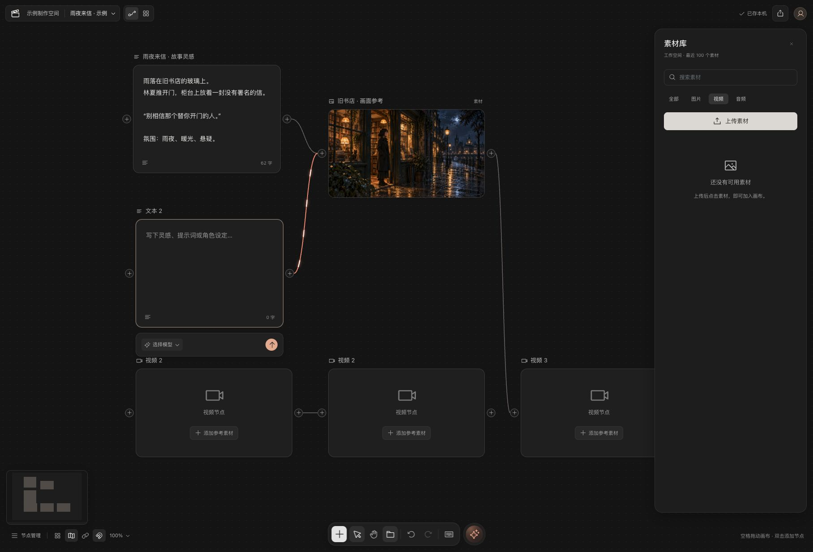
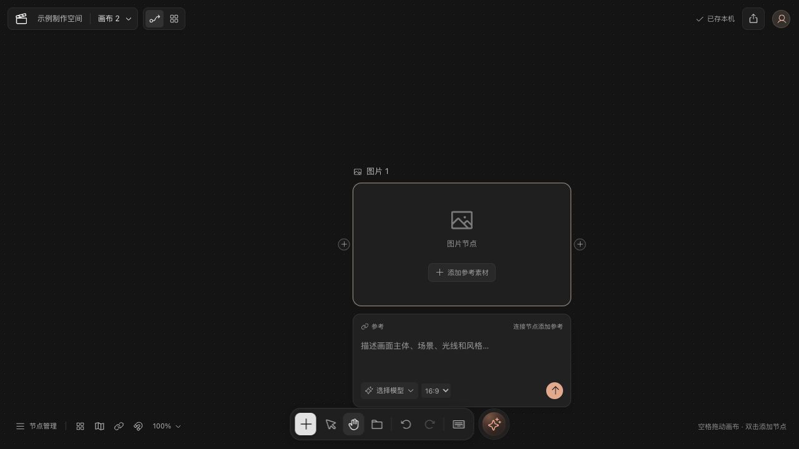
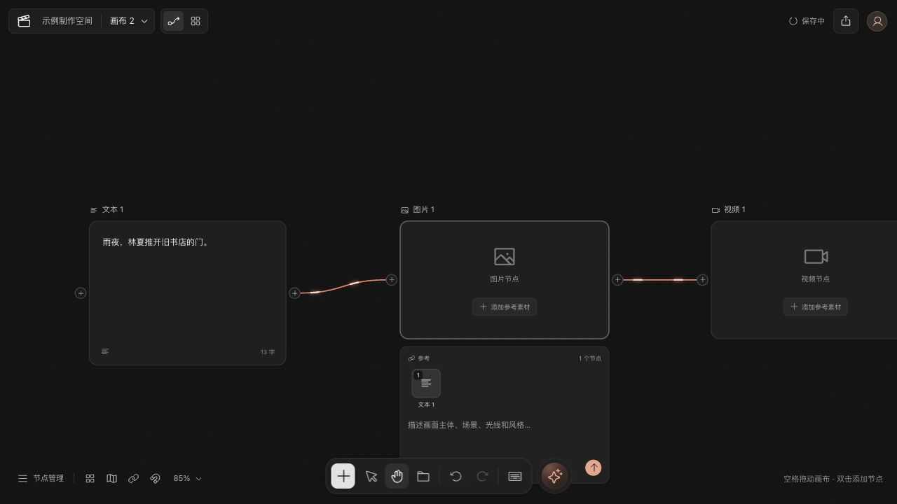
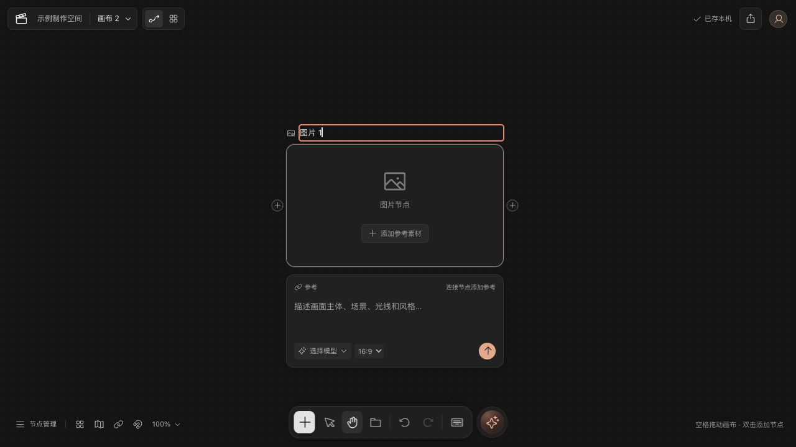
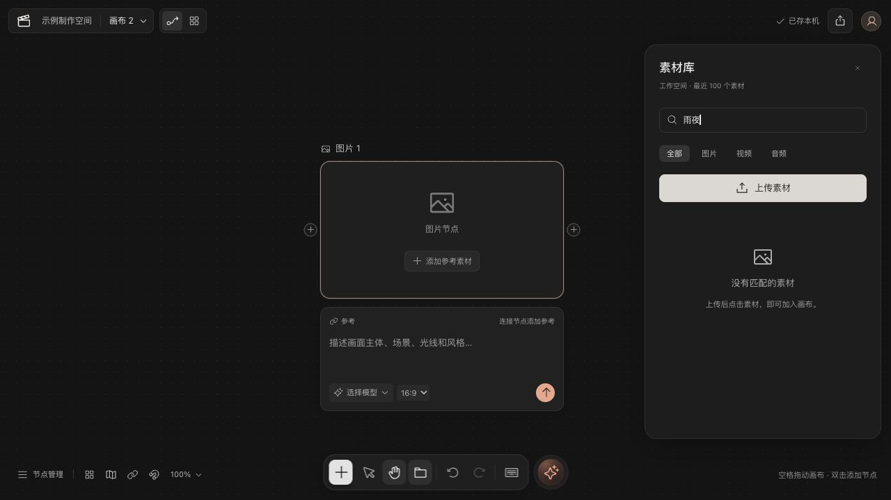
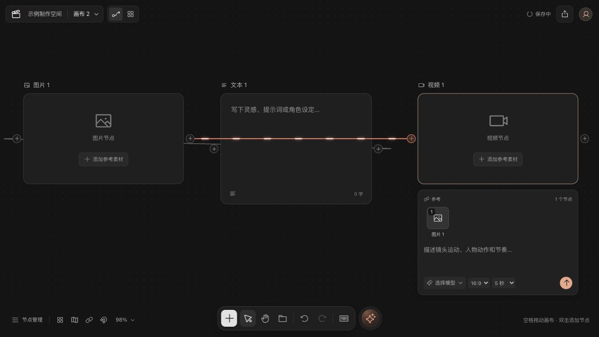
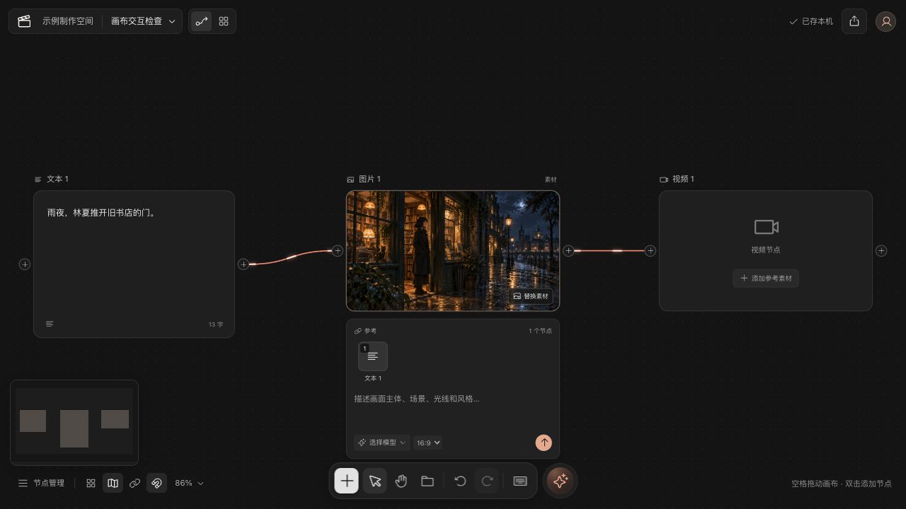

# 画布交互检查 · 2026-10-12

本轮确认并修复了移动工具、编辑历史、Escape 退出、整理布局、连线层级与自动命名问题。底部五项视图控制均有实际功能，已逐项操作验证。没有新增测试用例。

后续调整：连线开关现在只隐藏普通连线，选中节点的关联流动连线仍显示；连线与吸附关闭时均以图标斜线表示。以下显隐记录保留为原轮次验收，最新行为与验证见 [开关状态与选中连线可见性](../design-qa.md#追加调整开关状态与选中连线可见性)。

## 范围与方法

目标是完成“添加节点 → 编辑 → 建立参考 → 整理 → 平移/缩放 → 撤销恢复”的创作流程。先查看 15173 当前用户画布，随后在 15174 独立预览端口的新画布“画布交互检查”复现和验收；不重排、删除用户正在编辑的 15173 内容。原 15174“画布 1”保留。

所有证据均来自本轮浏览器截图、可见 DOM 和本地源码。当前用户画面为 1816 × 1234，独立复现与修复后画面均为 1280 × 720。未将不同尺寸画面冒称为逐像素对照。

| 步骤 | 流程 | 结果 |
| --- | --- | --- |
| 1 | 当前画布与创建节点 | 既有引用与素材能显示；发现已有同名视频节点。自动命名已避重，未修改既有名称。 |
| 2 | 手形工具移动画布 | 已修复：拖动节点表面只平移视图，节点坐标保持不变。 |
| 3 | 编辑、撤销与重做 | 已修复：仅聚焦名称/文本不创建历史或清空重做，第一次实际修改才建立编辑撤销点。 |
| 4 | 抽屉搜索与菜单退出 | 已修复：输入框内 Escape 可关闭抽屉和画布菜单，将焦点返回画布；输入法组合期间不拦截。 |
| 5 | 连接与整理 | 已修复：按上游到下游排列，连线在节点下方，保留引用和一次撤销/重做。 |
| 6 | 底部视图控制与保存 | 小地图、连线显隐、网格吸附、缩放和整理均通过手动操作；刷新保留节点、引用与视图偏好。 |

## 1. 当前画布与自动命名

当前画布已有两个“视频 2”，新建名称原先由同类节点数量推导，删除节点后可能撞名。现在从可用编号中选择不重复名称；实测已有“视频 2”时新建得到“视频 1”，撤销恢复原图。用户自己编辑的名称不强制唯一。

## 2. 移动工具

原先切到手形工具后，节点拖拽仍然启用。复现时节点从 (460,200) 移到 (565,261)，视图仍是 (0,0)。修复后，手形状态关闭节点拖拽、选择和连接命中；同样从节点表面拖动，节点保持 (520,0)，视图从 (47,243.106) 移到 (127,288.106)。空格临时平移也使用相同状态，松开和窗口失焦时释放；文本框空格不被拦截。

## 3. 编辑历史

原先名称、提示词、比例和时长控件在 focus 时就建立撤销点，点击但不修改也会清空重做。实测修复前重做按钮由可用变为禁用；修复后聚焦图片名称仍可重做整理。另实测填写文本 → 撤销为空 → 重做恢复原文。参数改为实际 change 时记录，画布重命名按首次有效编辑记录。

## 4. 搜索与退出

原先快捷键处理会先跳过输入框，因此素材搜索里按 Escape 无效。修复后，在搜索框输入“雨夜”并按 Escape，抽屉立即关闭；画布重命名输入框也可退出。已有输入内容不因 Escape 被回滚。

源码检查另发现：关闭上传抽屉后，尚未完成的上传仍可能触发旧的选择回调。已加卸载保护，阻止旧抽屉给后来选中的节点添加素材；已开始的文件上传不因此宣称被取消。这条保护尚未在慢网场景实测。

## 5. 连接与整理

原先按创建顺序三列排开，复现“文本 → 图片 → 视频”时，图片排在文本左边，图片到视频的线盖过文本正文。现在先按引用关系分层，源在左、目标在右；有环时折叠环分组，保证全部节点有位置，保留原引用。未连接节点独立排布，预留节点编辑区空间。取消 Vue Flow 的选中连线上浮，连线不再盖住节点内容。

初轮回归时还发现：吸附开启后，轻微点击位移会触发拖动，让位于 x=520 的图片节点跳到 x=528。追加 5 px 拖拽阈值，并将整理坐标对齐 16 px 网格，最终文本、图片、视频的列位置为 x=0、512、1024，两条引用保持完整。整理撤销/重做可用；重复点击已整理的画布只调整视图，不添加空历史。循环图和 200 节点压力未做浏览器实测，不承诺所有密集图连线均无交叉。

最终回归：撤销整理后点击图片内容，位置保持 (528,0)，重做按钮仍可用；重做后恢复 (0,0)、(512,0)、(1024,0)。控制台 error/warn 为空。

## 6. 底部按钮核验

| 按钮 | 实测结果 |
| --- | --- |
| 整理画布 | 按引用方向重新定位，并适合屏幕；一次撤销/重做恢复。 |
| 小地图 | 开关控制小地图显示，反映节点位置。 |
| 显示/隐藏连线 | 隐藏时图中仍有 2 条边，SVG visibility=hidden，流光路径为 0；再次打开恢复。 |
| 网格吸附 | 开启后拖动文本节点，位置落到 (32,32)，符合 16 像素网格。 |
| 缩放 | 选择 50% 后实际 viewport scale=0.5；整理/适合屏幕重新容纳节点。 |

## 验证边界与后续

构建含 TypeScript 检查、格式检查通过。Docker 仅更新 web，未重启 API 或数据库。浏览器控制台检查无 error/warn。现有节点正文、素材缩略图、上游参考、流光和本机保存均正常。

本轮可见的键盘焦点和 Escape 问题已修复；没有据此宣称完整无障碍合规。未实测真实触屏、读屏器、空格按住拖动、慢网上传取消、多标签冲突恢复、配额耗尽或 200 节点压力。模型执行、服务端画布存储与视频渲染仍不属于当前编辑器已接入能力。
