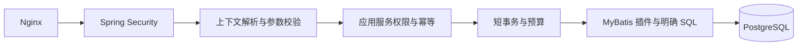

# Java 工程规范：持久化、日志与运行保障

本文件描述后端工程的目标约束，配合 [总体架构](architecture.md) 和 [接口契约](contracts.md) 使用。当前已实现的底座、配置与启动方式见 [运行说明](running.md)；文中的任务、账本、链路追踪等后续能力不能视为已经实现。当前版本采用构建、实际启动和接口请求验证，未引入测试用例。

## 2026-10-11 底座结构复核

当前结构适合继续开发模块化单体，已审查 12 个 Maven 模块的直接依赖、源码包引用、Controller 调用、事务入口及 Mapper SQL 归属。未发现依赖环、业务模块跨模块引用 internal、Controller 直接调用 Mapper 或公开 DTO 暴露内部持久化对象。该结论来自本次源码审查；目前没有 CI 自动阻断架构违规。

本次修正：

- 媒体应用服务只接收流和元数据；MultipartFile 与 Range Resource 留在 web，存储端口归 application.port，本地实现归 infrastructure.storage。文件流传输仍在数据库事务外，写入元数据时保留事务和回滚清理。
- 统一 JSON 和 MVC 参数的日期时间处理，Clock 在底座提供 UTC 微秒精度。业务不添加格式注解或逐接口转换。
- 媒体配置采用类型绑定，单文件大小上限由 Servlet 与服务共同使用。启动时校验请求大小、连接池上下限、慢 SQL 阈值；prod 在任何存储/数据源初始化前检查显式数据库地址和绝对媒体目录。
- migrate 不初始化本地媒体服务或目录，迁移容器不挂载媒体目录。开发 Compose 显式传递可调参数，私有文档允许已认证用户访问。clean package 清理移动包后残留的 class。

保留的实施边界：workspace/content 采用应用服务加 Mapper 的简单分层，复杂领域规则形成后再抽取 domain；公开命令的字段校验目前主要在 HTTP 边界，未来后台入口需要同样校验。jobs、models、assets、generation、editing、usage、workbench 仍是骨架，智能画布尚未实现。生产网关、登录限流、审计、备份恢复及负载容量验证需要在上线前落实。

## 持久化选型

采用 **MyBatis-Plus 3.5.17 + 自定义 XML SQL + HikariCP + Flyway**。MyBatis-Plus 用于减少模块内部的常规持久化代码，预算、任务和版本规则仍由业务命令及明确 SQL 实现。

官方提供 `com.baomidou:mybatis-plus-spring-boot4-starter`，当前安装页列出的版本为 3.5.17。父 POM 统一该版本，使用对应 BOM 管理 MP 组件；租户插件需要的 `mybatis-plus-jsqlparser` 与其对齐。不同时引入原生 MyBatis Starter，也不单独覆盖 MyBatis/MyBatis-Spring 版本。Boot 4.1.x 的最终组合通过 P0 构建和集成测试后锁定。[官方安装说明](https://baomidou.com/getting-started/install/)

| 场景 | 实现方式 |
|---|---|
| 项目、资产等简单新增和查询 | 内部 BaseMapper、LambdaQueryWrapper，持久化 DTO 不出模块 |
| 工作空间列表和复杂筛选 | 明确查询 DTO、XML SQL、游标分页、字段白名单 |
| 镜头修订和选片更新 | XML 条件更新 workspace_id、id、expectedRevision，检查影响行数 |
| 预算预占、结算和释放 | XML SQL、唯一约束与短事务；BigDecimal 对应 NUMERIC |
| 任务领取、续租和完成 | PostgreSQL 专用 SQL，显式租约与 token 条件 |
| 写入多条分镜或批次记录 | 有界批量 SQL，固定事务边界，不循环提交每一行 |
| 跨模块读写 | 调用该模块公开接口；组合列表必要时使用 workbench 自有投影 |

`BaseMapper`、Entity、Wrapper 位于各模块 `internal.infrastructure.persistence`。公开 API 不暴露 `IService`、`ServiceImpl`、`IPage` 或条件 Wrapper；不建立继承通用 CRUD 的公共业务 Service。Controller 不能注入 Mapper。首版 DTO 转换采用显式构造，出现大量稳定转换后再评估 MapStruct。

## 插件和工作空间隔离

初始只启用普通 Mapper 的 `TenantLineInnerInterceptor`，租户字段为 workspace_id。接口采用游标分页，版本更新采用显式 CAS，因此无需再叠加分页和乐观锁插件。逻辑归档使用明确的 archived_at 和领域命令；账本、修订和任务不套统一逻辑删除规则。

租户插件会改写 SQL，因此它的覆盖和绕过必须明确，不能假定 XML 自动免拦截。[租户插件](https://baomidou.com/plugins/tenant/)、[插件机制](https://baomidou.com/plugins/)

执行规则：

1. 请求完成认证及成员校验后建立执行作用域。持久化适配层从明确的 ExecutionContext 建立插件需要的工作空间上下文；缺失或不匹配立即失败。
2. Worker 领取任务后，依据任务中已持久化的工作空间和来源建立作用域。ThreadLocal 只作为同线程插件桥接，所有入口用 try/finally 清理；不继承 Web 线程身份，不使用默认租户。
3. 插入时 workspace_id 由服务器填写。已包含租户列的 INSERT 不能只依赖插件补列，Repository 还要检查该值与执行上下文一致。
4. 全局用户、Session 和显式全局配置的查询有准确入口清单；经过 MyBatis 的全局查询按完整 mappedStatementId 登记绕过。MP 的 ignoreTable 回调接收裸表名，不能直接实现 schema 级隔离白名单，避免因不同 schema 同名表而扩大忽略范围。Session JDBC 等不经过 MP 的访问另按所属组件限制。
5. 预算、任务、复杂 CTE 等精确 SQL 按完整 mappedStatementId 登记绕过改写；预算和业务 SQL 自身必须绑定 workspace_id。
6. 混合全局表与租户表的 SQL 同样按 statement 审查并显式绑定 workspace；全局任务领取、租约扫描属于受控 jobs 内部入口，明确可跨工作空间。领取后业务操作恢复到对应工作空间作用域。不存在可由 HTTP 参数开启的全库模式。
7. 绕过以单个 statement 审查，禁止类级忽略、包级通配和 Controller 动态关闭。白名单由启动校验确认映射存在，CI 覆盖每一个绕过项。

租户插件负责补充工作空间条件，不能代替项目级授权。成员权限、对象引用归属和供应商账号使用权仍由公开应用服务校验。任何 SQL 解析失败都报错，不降级为跳过隔离。裸表名处理范围已依据 [MP 3.5.17 租户拦截器源码](https://github.com/baomidou/mybatis-plus/blob/v3.5.17/mybatis-plus-jsqlparser-support/mybatis-plus-jsqlparser/src/main/java/com/baomidou/mybatisplus/extension/plugins/inner/TenantLineInnerInterceptor.java) 审查。

`BlockAttackInnerInterceptor` 不作为首版全局插件：存在 WHERE 不代表工作空间正确，也不代表更新范围安全。通过明确条件、影响行数校验和真实数据隔离测试约束修改；后续若启用防全表操作插件，先对专用 SQL 做兼容回归。[插件能力范围](https://baomidou.com/plugins/block-attack/)

## 请求处理、拦截器与通用组件

按执行层分配职责，使用框架现有扩展点；初期不建立自研通用拦截框架。

| 层次 | 组件 | 职责与边界 |
|---|---|---|
| Servlet 入口 | Boot HTTP Observation，加一个薄的 RequestCorrelationFilter | 复用 traceId，生成或校验 correlationId、记录一次请求摘要、清理 MDC；不缓存完整请求/响应体 |
| 安全过滤链 | Spring Security SecurityFilterChain | Session 身份、CSRF、安全响应头及路由权限；使用框架提供的过滤器 |
| MVC 参数解析 | ExecutionContextArgumentResolver | 从认证主体和路由解析工作空间，调用 workspace 公开接口验证成员；形成显式 ExecutionContext |
| Controller 参数 | Jakarta Bean Validation | 必填、长度、格式、集合大小和参数范围；资源权限及预算由应用服务继续校验 |
| 应用服务 | 明确的权限检查、IdempotencyService、事务命令 | 对象归属、命令去重、预算预占和持久化在统一用例中执行；覆盖 HTTP 与后台入口 |
| 数据访问 | MP 租户插件 | 普通 SQL 工作空间过滤；精确 SQL 按审查白名单执行 |
| SQL 诊断 | SqlObservationInterceptor | Mapper 标识、耗时、行数、错误分类；不打印参数 |
| 外部 HTTP | RestClient 拦截与 Resilience4j | 关联调用、显式超时、熔断与本进程并发隔离；提交重试服从供应商幂等能力 |
| 错误响应 | RestControllerAdvice 与 Security 专用错误处理器 | Controller 和安全过滤链分别处理异常，输出一致的错误结构 |

RequestCorrelationFilter 是计划实现的适配组件名；IdempotencyService 表示模块内部的命令去重协作者，不是新增公共模块，也不拥有所有业务表。组合命令去重仍归 workbench，直接模块命令由所属模块维护。

请求关键路径如下，观察与日志包围整个请求；校验和授权会在相应层提前拒绝请求：



身份认证与安全控制放在 Spring Security 过滤链及应用服务。MVC HandlerInterceptor 可以处理轻量的 MVC 附加信息，但不作为登录、工作空间权限或幂等的唯一入口；首版无需专门再写一套 LoginInterceptor。[Spring Security 架构](https://docs.spring.io/spring-security/reference/servlet/architecture.html)、[Spring MVC 拦截器说明](https://docs.spring.io/spring-framework/reference/web/webmvc/mvc-config/interceptors.html)

安全和上下文需要明确以下行为：

- 普通 `/api/v1/**` 使用 Session 并校验写请求 CSRF；项目、镜头和媒体的访问规则在应用服务执行。首次成员查询用认证 actorId 与指定 workspaceId 的明确 SQL，验证成功后才能建立租户作用域，不能先把路由 ID 当成已授权身份。
- 供应商回调使用独立且精确匹配的安全链，不使用浏览器 Session。只为这些路径配置 CSRF 例外，按供应商协议验证原始请求签名、时间窗口及回调去重，验证后持久化到收件箱；不放开整个 API。
- 多条 SecurityFilterChain 使用明确顺序和兜底拒绝规则。自定义 Filter 只注册一次，避免同时被 Servlet 容器与 Security 链执行。
- 401/403 由 AuthenticationEntryPoint、AccessDeniedHandler 返回统一错误，不能只写一个 ControllerAdvice 就认为所有入口都已覆盖。
- 请求关联 ID 做长度与字符限制，不能用于身份或权限决策。工作空间和 actorId 从验证过的上下文取值；不接受客户端任意指定用于跨租户查询。
- SSE、错误派发和异步请求要测试 MDC 清理、日志次数及连接关闭。SSE 连接持续时间单独观测，不能按普通 API 的短请求阈值不断报慢请求。

幂等的数据库唯一约束和去重记录与业务接纳同事务提交。Filter 最多检查 Idempotency-Key 的格式，不能用一次缓存判断或一个内存锁保证不重复付费。审计成功记录也与业务修改同事务，通用 AOP 的方法返回日志不能代表事务最终提交。

事务采用应用服务层的 Spring 事务或显式 TransactionTemplate。跨模块调用共享事务管理器；同类自调用不能假定会经过事务代理。预算和引用保留由本模块守住不变量，不能依赖某个 Controller 被调用过。

统一错误结构使用明确的 DTO/ProblemDetail 映射，保留正确 HTTP 状态。首版不全局套 ResponseBodyAdvice 自动包装响应，避免改变 SSE、文件、签名访问和标准错误的协议。业务响应直接使用 OpenAPI 定义的 DTO。

组装归属：boot 负责过滤器顺序、错误格式、SQL 诊断和框架配置；workspace 提供身份与成员查询、Web 上下文解析；workbench 和各领域模块拥有命令规则；models 拥有供应商调用策略；jobs 建立后台执行边界。基础组件不通过扫描所有 Service 的万能切面修改业务行为。

## SQL 和数据库约定

- schema 和表名使用固定小写 snake_case；每张表只有一个所属模块。迁移统一由 Flyway 执行，生产应用不自动建表、修表。
- 业务租户表包含非空 workspace_id；关键关联使用模块内的组合外键或唯一约束。全局表必须在隔离清单中明确登记。
- ID 在 HTTP 中统一为字符串，数据库首选 UUID；具体生成算法由单一 IdGenerator 实现，不依赖 MP 默认雪花节点配置。
- created_at、updated_at 使用 TIMESTAMPTZ；不可变修订只追加。时间序号和业务 revision 使用 BIGINT；revision 不与业务状态混成一个字段。
- 金额使用 NUMERIC(20,6) 和币种，不用 float/double。计价精度、金额上界、舍入和账单对账规则由 usage 统一定义。
- 状态使用有 CHECK 约束的文本或受控代码，Java 枚举显式映射；不保存 ordinal。旧 Worker 不认识新状态时停止处理并告警。
- 所有用户值使用 `#{...}` 绑定。动态排序由后端枚举映射为固定 SQL 片段；禁止让用户输入进入 `${...}`、表名、列名或 SQL 表达式。
- 列表明确列名，禁止无界全量查询和大 JSON 字段随列表返回。游标包含稳定排序键和 ID；每页上限初设 100，批量 ID 查询初设 200，均可按实测调整。
- 关闭 MyBatis 二级缓存，首版不缓存权限、预算、任务状态。统一一级缓存范围为 STATEMENT，减少长会话内的陈旧读取。
- 条件更新必须检查影响行数；单对象命令期望恰好一行。零行先按安全范围区分不存在、版本冲突或额度不足，不静默当成功。
- 状态变迁和审计/账本/下一步任务保持同事务；同一事务只做数据库操作。固定锁定顺序，多预算时按 ID 排序锁定，减少死锁。
- 序列化冲突或死锁仅对纯数据库、幂等的完整事务做有限重试；禁止重试包含外部付费副作用的整个方法。

典型版本更新，镜头快照追加与当前头更新在同一事务内：

```sql
UPDATE content.shot
SET current_revision = current_revision + 1,
    selected_candidate_id = #{candidateId},
    updated_at = CURRENT_TIMESTAMP
WHERE workspace_id = #{workspaceId}
  AND id = #{shotId}
  AND current_revision = #{expectedRevision}
  AND archived_at IS NULL;
```

条件预算预占示例；参数先校验正数和币种，预占明细及命令去重在同一事务。多个预算口径使用固定顺序原子检查：

```sql
UPDATE usage.budget
SET reserved_amount = reserved_amount + #{reserveAmount},
    updated_at = CURRENT_TIMESTAMP
WHERE workspace_id = #{workspaceId}
  AND id = #{budgetId}
  AND currency = #{currency}
  AND limit_amount - spent_amount - reserved_amount >= #{reserveAmount};
```

任务领取采用短事务，先锁行再更新租约与 token。下面只展示领取候选部分；任务状态推进、回收过期租约和 token 更新须由同一任务存储实现完成：

```sql
SELECT id
FROM jobs.job
WHERE status = 'QUEUED'
  AND kind = #{jobKind}
  AND available_at <= CURRENT_TIMESTAMP
ORDER BY available_at, id
LIMIT #{claimLimit}
FOR UPDATE SKIP LOCKED;
```

调度器不能领取超过本进程即时执行容量的任务，避免任务在本地排队时租约已经到期。正常供应商 RUNNING 轮询属于重调度，只推进 available_at；execution_count 和 failure_count 分开，正常等待不消耗失败次数。业务超期进入核对流程，不能直接释放费用。

索引按访问路径设计，初始至少覆盖：

| 用途 | 索引或约束 |
|---|---|
| 工作空间项目列表 | content.project(workspace_id, created_at, id)，按归档查询考虑部分索引 |
| 镜头修订 | UNIQUE(workspace_id, shot_id, revision) |
| 预算预占 | UNIQUE(workspace_id, operation_id)；追加账单事实唯一键 |
| 接纳命令去重 | UNIQUE(workspace_id, command_type, idempotency_key) |
| 待领取任务 | jobs.job(kind, available_at, id) WHERE status = 'QUEUED' |
| 过期租约回收 | jobs.job(lease_until, id) WHERE status = 'RUNNING' |
| 事件投递与收据 | UNIQUE(event_id, consumer_key)、UNIQUE(consumer_key, event_id) |
| 工作空间活动重放 | UNIQUE(workspace_id, cursor) |
| 媒体引用保留 | UNIQUE(workspace_id, media_version_id, owner_type, owner_id)；按媒体版本查询索引 |

索引不能只在空库验证。用包含多工作空间、历史任务和长剧本的种子数据，针对热点查询分析 EXPLAIN (ANALYZE, BUFFERS)；写语句的 ANALYZE 仅在隔离测试数据库执行。给高更新任务表规划清理、归档与 autovacuum，不能持续堆积完成任务而只优化 SELECT。

## 应用日志与审计

采用 **SLF4J 2 + Logback + Spring Boot 原生 JSON 日志**。开发环境可读文本，生产 stdout 输出 ECS JSON，由容器平台收集；不再额外引入 JSON encoder。Boot 原生结构化日志支持 MDC 与 SLF4J 的键值字段。[Spring Boot 日志文档](https://docs.spring.io/spring-boot/reference/features/logging.html)

每条日志按可得信息携带：service.name、deploymentRole、module、event、traceId、spanId、correlationId、workspaceId、actorId、operationId、jobId、executionCount、durationMs、outcome、errorCode。业务 ID 放日志和追踪，不作为 Micrometer 标签。

| 类型 | 记录位置与内容 |
|---|---|
| HTTP 完成日志 | 一次请求一条摘要：路由模板、状态、耗时和关联标识；不记录请求体、完整 query 或 Cookie |
| 任务日志 | 领取、重要状态变更、重试和最终结果；普通轮询仅采样或 DEBUG，避免每次查单刷 INFO |
| 供应商日志 | 供应商/模型标识、接口类型、耗时、状态码、已脱敏的错误码和请求关联；不保存原始响应全文 |
| SQL 诊断 | statementId、耗时、更新行数或结果数量、SQLState、错误类别；不记录参数和值 |
| 操作审计 | 登录和成员变更由 workspace 记录；工作台命令由 workbench 记录 actor、对象、动作、修订、结果和请求号 |
| 费用事实 | usage 的持久化账本；不可用日志或追踪抽样代替 |

审计成功记录与对应业务修改同事务提交。失败或拒绝操作在独立的入口诊断中记录；不能为了留下失败审计而提前提交业务。既有领域记录是事实源，审计只记录行为与引用，避免重复存一份剧本或费用状态。

异常在最终处理边界记录一次。预期的参数错误、409 冲突和权限拒绝不打印成堆 ERROR；未知异常生成 traceId 返回客户端。对数据库和供应商异常，原始 message、cause、DETAIL 可能含输入值，须由边界转成安全错误类别及经清理的栈帧；不能直接 `log.error(..., exception)` 把原始 SQL 或响应再次泄漏。

提示词、剧本正文、配音文本、密钥、Authorization、Cookie、签名 URL、文件二进制禁止进入常规日志。生成输入保存在受权限控制的业务记录中，通过 operationId 排查。业务字段使用白名单结构化写入，防止换行注入；自动脱敏是补充，不能靠正则过滤所有敏感内容。

API、Worker 每个执行入口建立 MDC 并在 finally 清理。长任务每次执行建立新 span，通过 operationId 和生产方 trace context 关联；不维持数小时打开的 HTTP span。HTTP 客户端使用 Boot 提供的 RestClient.Builder，内部追踪采用 Micrometer 与 OpenTelemetry；向外部供应商传播的字段保持最小集合。[Spring Boot 追踪](https://docs.spring.io/spring-boot/reference/actuator/tracing.html)

生产容器日志初始按每文件 10 MB、每容器 3 份限制本地占用，集中保留期另配置。临时提高日志级别须限定 logger 和到期时间，不能通过公开 Actuator 将全站改为 DEBUG。普通诊断允许受控采样；账本和关键审计不采样。监控日志采集丢弃和磁盘占用。

## SQL 日志与慢查询

默认所有环境的 Mapper 保持 INFO。DEBUG 也会输出绑定参数，TRACE 还会输出结果；只能在本地隔离、仅合成数据的排障环境，对指定 namespace 临时开启。真实项目数据与共享测试环境禁止参数日志。P6Spy 适用相同限制，不加入生产运行依赖。[MyBatis 日志级别](https://mybatis.org/mybatis-3/logging.html)、[MP 的 P6Spy 集成](https://baomidou.com/guides/p6spy/)

生产保持 Mapper INFO，禁止 StdOutImpl 和展开参数 SQL。实现一个小型 MyBatis 诊断拦截器，只收集 mappedStatementId、命令类型、执行耗时、影响行数与安全 SQLState。计时明确为 Mapper 调用耗时，可能包含对象映射，不冒充纯数据库执行耗时；避免 Executor 重载链重复计数。批处理行数在 flush 后统计，不能把 JDBC 未确定计数记为零。

初始慢调用阈值 200 ms，按 statementId 限频记录；超过 1 s 的调用单独计数和告警，阈值在样片及负载验证后调整。慢调用日志示意：

```json
{
  "event": "sql.slow",
  "module": "content",
  "statementId": "ShotMapper.findPage",
  "durationMs": 245,
  "resultCount": 40,
  "workspaceId": "ws_demo",
  "traceId": "example_trace",
  "outcome": "SUCCESS"
}
```

PostgreSQL 使用 pg_stat_statements 聚合耗时与调用次数；涉及 query 文本的诊断视图只向受控运维账号开放。它需要服务端配置与扩展安装，列入基础设施迁移，不由应用随意创建。[pg_stat_statements](https://www.postgresql.org/docs/18/pgstatstatements.html)

数据库日志另外配置 bind 参数长度为 0，并控制错误 DETAIL、语句日志及访问权限。`log_parameter_max_length=0` 与 `log_parameter_max_length_on_error=0` 只能限制绑定参数日志，不能保证错误详情或写在 SQL 字面量里的值消失；应用持续使用参数绑定，数据库错误详情不转发到应用常规日志。[PostgreSQL 日志参数](https://www.postgresql.org/docs/18/runtime-config-logging.html)

## 配置与资源边界

以下是生产配置方向，完整文件由 P0 根据真实依赖生成：

```yaml
spring:
  application:
    name: drama-api
  datasource:
    hikari:
      maximum-pool-size: 10
      minimum-idle: 2
      connection-timeout: 3000
  flyway:
    enabled: false

mybatis-plus:
  configuration:
    map-underscore-to-camel-case: true
    cache-enabled: false
    local-cache-scope: STATEMENT
    log-impl: org.apache.ibatis.logging.slf4j.Slf4jImpl

logging:
  level:
    root: INFO
    com.yucheng.drama: INFO
  structured:
    format:
      console: ecs

management:
  endpoints:
    web:
      exposure:
        include: health,info,prometheus
  endpoint:
    health:
      show-details: when_authorized
```

连接池数值是单实例起点：API 10、模型 Worker 5、媒体 Worker 5；扩副本时按总和预留迁移与运维连接。供应商等待不占数据库连接，FFmpeg 执行也不持有事务。数据库超时、锁等待超时和应用命令期限统一配置；超时不能把不确定的供应商提交误认为失败。

Flyway 默认在业务进程关闭，由独立 migration 入口以迁移账号执行。迁移脚本不可修改已执行版本；脚本版本全局唯一。创建大索引等不支持普通事务包装的操作使用独立迁移，发布前验证旧 Worker 兼容。

Actuator 管理端口只对运维网络开放并认证；prometheus 路由需引入对应 registry 才存在。健康检查区分进程存活与可接流量；供应商短暂不可用不应导致所有 API 被重启。数据库池指标可使用 Boot 的 JDBC/Hikari 指标。[Actuator 指标](https://docs.spring.io/spring-boot/reference/actuator/metrics.html)

HTTP、供应商提交、下载、渲染使用各自有界并发和期限。虚拟线程不改变连接数或供应商额度上限。后台执行器停止时先停止领取新任务，有限等待在途工作，保留可恢复租约；不得在 shutdown 中无限等待。

## P0 必须验收的工程能力

1. Maven 依赖树中只有一套匹配的 MP/MyBatis/Spring 组合，三个角色均能启动；真实 PostgreSQL 完成迁移与 Mapper 冒烟测试。
2. 普通 CRUD、XML、JOIN、INSERT、批量写入和每个绕过 statement 均验证租户隔离；无上下文必失败，任务线程复用不串租户。
3. 并发 revision 更新、预算争抢、任务领取和过期租约恢复在 PostgreSQL 测试中符合约束，不用 H2 替代相关语义。
4. 在测试输入中植入可辨认的假密钥、剧本文本、签名查询串，触发校验错误、SQL 错误及供应商错误；HTTP、应用、SQL 和采集日志均不出现这些值。
5. 从一个 operationId 可检索到 API 接纳、Worker 执行、供应商回执、费用变动和产物就绪；服务重启后关联仍在。
6. 慢查询能定位到 statementId 和 traceId，统计无重复；连接池耗尽、队列积压和日志轮转有可观测结果。

当前已完成选型与规范审查；尚未创建实现、解析正式工程依赖或执行以上集成验收。本机默认 `java` 为 17，Maven 使用的运行时为 25，开工必须通过 Wrapper/Toolchains/CI 统一 Java 25，避免 IDE、命令行与构建运行时不一致。
