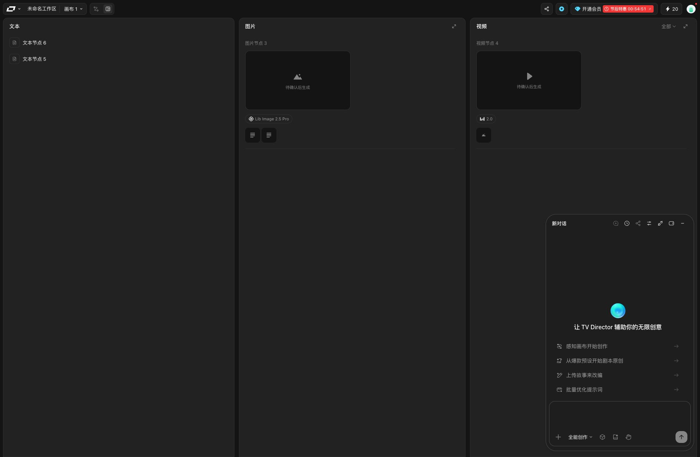
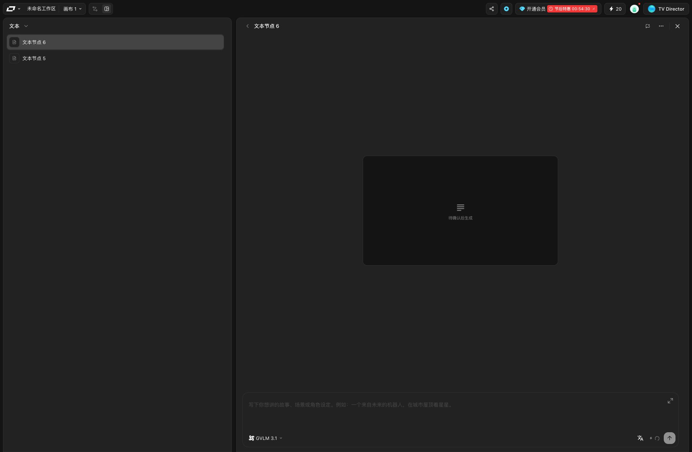
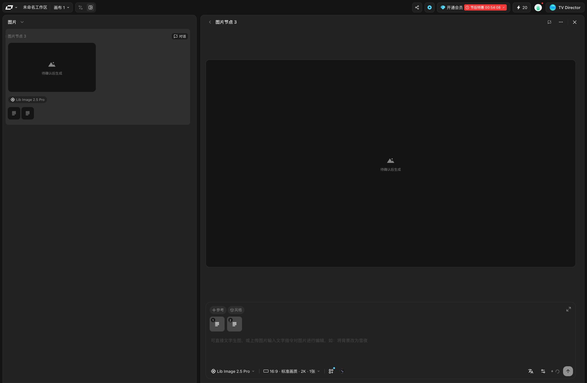
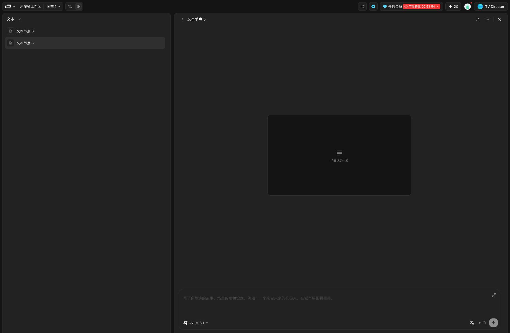
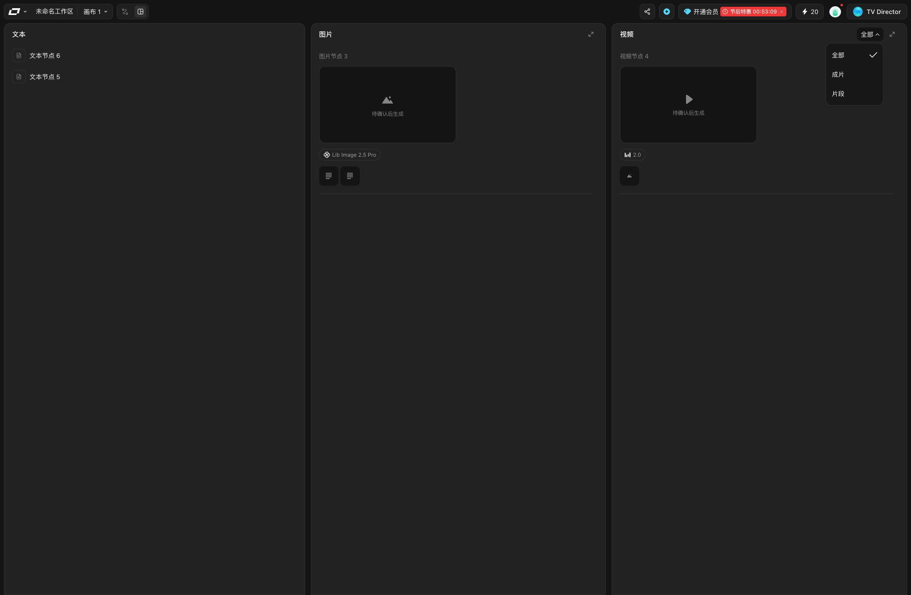
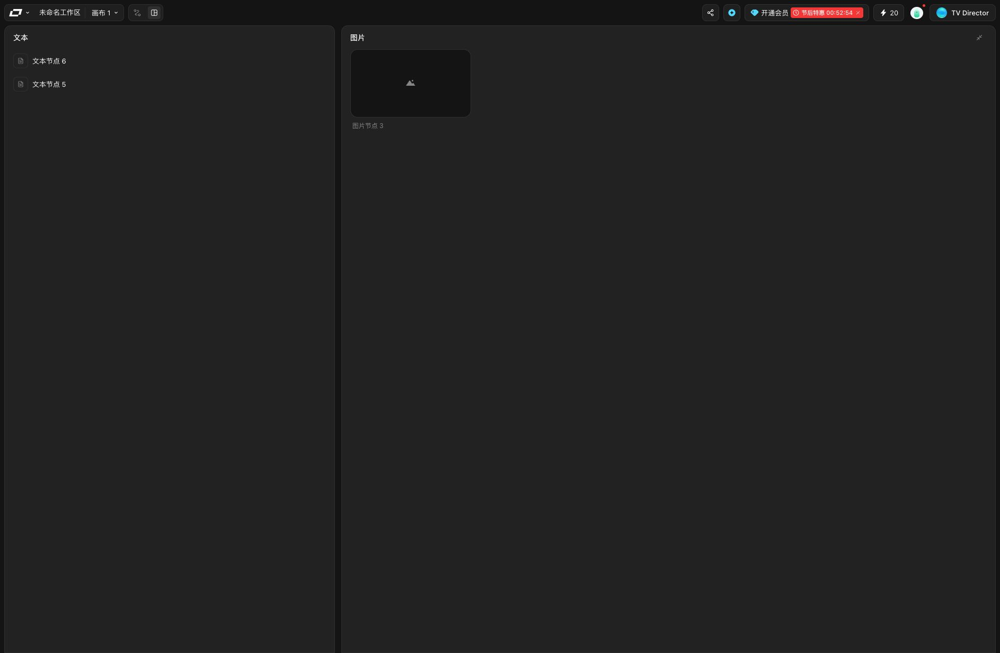
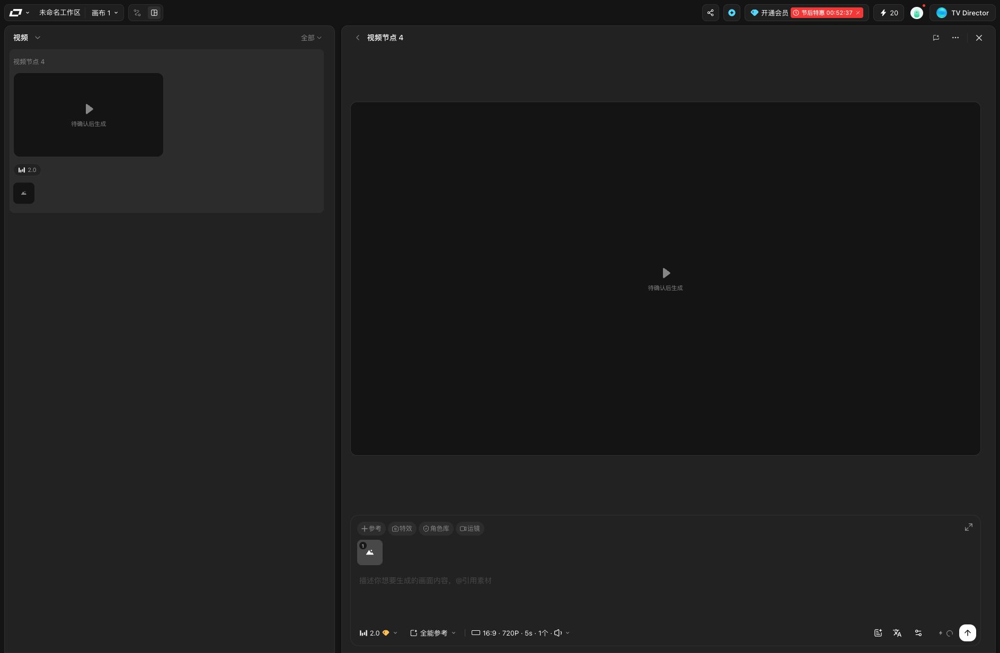
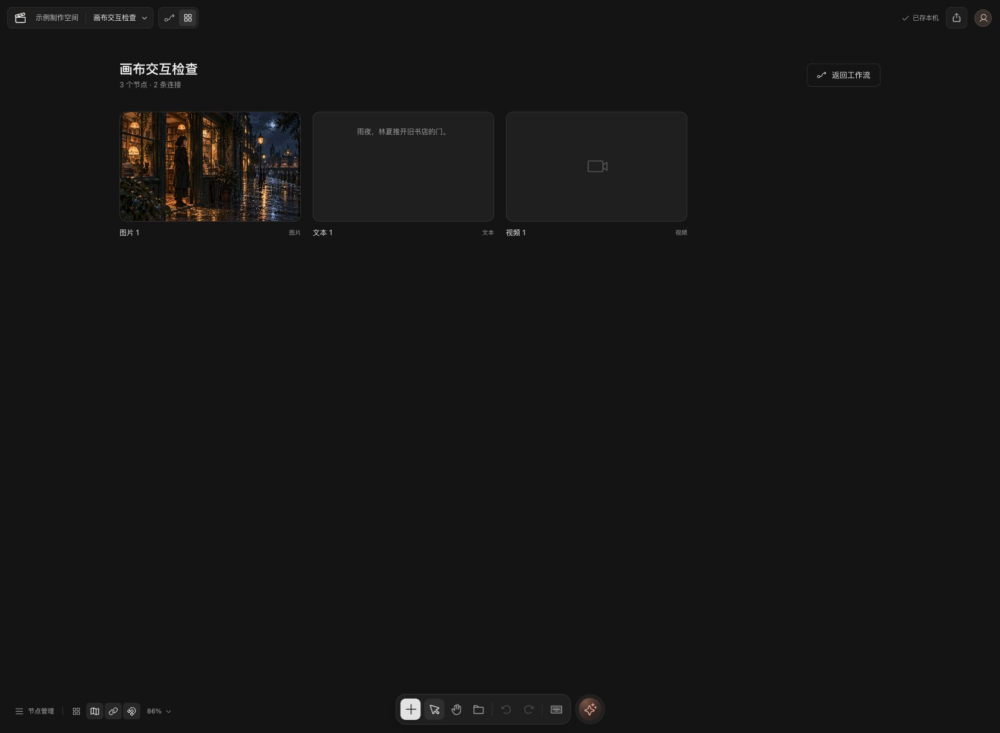

# 智能画布故事板：实查与改造方案

日期：2026-10-12。状态：调研方案已落实为 Vue 前端并部署到本地 Docker。下文保留改造前的观察和设计依据，当前实现与验收见 [设计验收记录](../design-qa.md)。

## 结论

应保留故事板入口，并重做其内容结构。它提供按内容类型阅读、检查与编辑节点的方式，适合逐项检查提示词、参考和产出；工作流视图负责空间布局、连线和分支关系。两个视图应操作同一批节点。

改造前只有按节点数组顺序展示的混合卡片，点击后切回工作流，没有故事板内的编辑闭环。本次已补上分类总览、同类详情、参考导航、共享编辑与独立排序。

“为什么这样做”是根据本轮观察作出的产品分析，不是 LibTV 官方陈述，也不代表已知其内部数据结构。

## 调研范围与证据

- 来源：[LibTV 当前项目画布](https://www.liblib.tv/canvas?spaceId=11180954&projectId=2c3a20880beb42888743923886372106)。使用当前登录的 in-app Browser 实际操作。
- 对照：本地 15174 的“画布交互检查”故事板及相关 Vue 源码。
- 未提交生成、发送对话、编辑内容或执行删除。来源页恢复到故事板总览和原有 TV Director 面板。
- 截图均为本轮实际捕获并重新打开确认。来源截图 1887 × 1234，本地截图 1682 × 1234；用于流程与结构比较，不是同尺寸视觉还原验收。
- 样本为两个空文本节点、一个待生成图片节点、一个待生成视频节点。详情与参考导航可实际验证；真实产出播放、重新生成、费用、失败重试、拖动排序持久化、跨端同步尚未验证。

## 逐步观察

### 1. 故事板总览：分类清楚

实际看到文本、图片、视频三个纵向区域。文本是紧凑列表，图片和视频显示预览、模型与参考缩略图；智能体面板可以保持打开。

价值：按当前任务集中寻找同类内容，减少在大画布中缩放、平移和寻找节点的负担。分栏不代表每一横行构成同一个镜头；本轮没有观察到跨栏按镜头对齐的语义。

风险：空内容时大栏面积很大，主要提示及次要文本偏暗。三栏本身不保证内容有叙事顺序。

### 2. 文本详情：保持列表上下文

点击文本节点后，左侧保留文本列表并标明当前项，右侧占据主要空间，显示内容区域与底部输入、模型入口。详情顶部有返回、添加到对话、更多和关闭。

价值：可连续处理多个文本对象，不必返回大画布。左侧模块菜单可切换到图片或视频。

限制：本轮节点为空，没有验证长文滚动与编辑后的保存。若直接复制这种空态，首次使用者不容易理解内容区和输入区的区别。

### 3. 图片详情：预览与生成输入共处

打开图片节点后，左侧保留图片列表，右侧为大预览；底部显示参考、风格、提示词、模型、比例、清晰度与数量。更多菜单可见设置关键元素、创建副本和删除，本轮没有执行这些动作。

价值：修改时同时查看输出与输入条件，减少来回定位。模型与上游参考不再藏在图的连线里。

### 4. 上游参考导航：来源可追溯

点击图片卡片的第一个参考缩略图后，打开“文本节点 5”详情并切换左侧到文本列表。点击返回，回到原“图片节点 3”详情。

价值：用户可以检查“这张图参考了什么”，并在处理后返回原对象。这里需要详情导航历史，而不是每次引用跳转都退出故事板。

### 5. 视频筛选：区分产物用途

视频栏筛选菜单提供全部、成片、片段。已打开并观察菜单，未验证两类对象的完整样本和分类依据。

分析：生成片段与最终成片承担不同任务，混在一起会增加选片成本。我们必须有真实的产物分类数据后再提供同名筛选，不能把所有 video 节点默认当成成片。

### 6. 放大图片栏：扩大审阅空间

点击放大图片，文本列表仍在左侧，图片集合占据右侧更大区域；点击收起恢复三栏。放大集合与打开单项详情是两个不同操作。

价值：前者用于浏览同类素材，后者用于检查和编辑某个对象。图片为空时，这个样本无法验证多图比较效率。

### 7. 视频详情：按类型提供输入能力

视频详情同样保留左侧列表、右侧预览、下方编辑区。实际可见图片参考、特效、角色库、运镜、模型、参考模式、画幅、清晰度和时长。图片和视频共用页面骨架，输入能力随节点类型变化。

价值：界面位置稳定，但避免所有类型共用一套不相关参数。本次只观察入口，没有提交模型任务。

### 8. 本地当前实现：缺少内容操作闭环

本地截图显示图片、文本、视频混排。源码 `CanvasPage.vue` 的故事板直接遍历 `nodes`；卡片调用 `focusNode()`，该函数切回工作流并定位节点。视频只有类型图标，未在此视图提供视频播放。底部仍保留网格吸附、节点连线、缩放、整理等针对空间画布的控件。

已有基础：节点和媒体复用已有数据，避免两份内容；图片能显示真实素材。主要缺口：未分类、未显示上游参考、没有就地详情与编辑、浏览排序没有明确语义、故事板仍展示不适用的画布控制。

## 我们采用的产品结构

| 状态 | 布局与操作 | 目的 |
| --- | --- | --- |
| 分类总览 | 文本、图片、视频三栏，各自滚动；文本栏包含剧本并显示类型，音频在有内容时提供可切换分类 | 快速找内容，覆盖既有五类节点 |
| 同类集合展开 | 扩大图片或视频集合，保留返回入口及阅读位置 | 集中比较素材 |
| 单项详情 | 左侧同类列表，右侧预览，下方编辑区；有明确的关闭与返回 | 连续检查、编辑内容 |
| 查看参考 | 故事板内打开上游详情，记录返回路径 | 追溯来源后继续当前任务 |
| 定位工作流 | 独立的定位动作，按需切到画布并选中该节点 | 修改连线与派生关系 |

其他规则：

- 进入故事板时隐藏空间画布专用控件；保留内容新增、素材、撤销/重做等适用动作。
- 文本直接显示实际内容；图片完整预览；视频和音频使用真实媒体播放控件。无产出时显示真实空态，不假装已经生成。
- 模型未接入时保持现有真实状态。不要复制竞品模型名、付费档位、特效或运镜入口来冒充可用能力。
- 复制、删除放在更多或右键菜单；删除与断开参考调用现有命令并支持撤销，不能只删除列表项。
- 文字、提示词和参数变更即时反映到工作流对应节点；两个视图切换保留各自阅读位置。
- 单项切换、关闭和返回都要有键盘操作及可见焦点；图标按钮有明确名称。拖动排序必须有键盘替代，不复制竞品偏暗的次要文字。

## 数据与组件边界

现有 `CanvasBoard.nodes / edges` 是两个视图的共同数据源。故事板不复制节点内容或媒体记录；引用卡片继续从入边推导。现有 `updateNode`、删除、复制、参考移除、checkpoint 和撤销历史需要抽成共享命令，避免第二套保存与历史逻辑。

建议组件拆分：

- `CanvasStoryboard`：总览、分类与列表状态。
- `StoryboardColumn`：同类集合、滚动位置、条目选择与集合展开。
- `StoryboardDetail`：当前条目、返回历史和定位工作流动作。
- `CanvasMediaPreview`：图片、视频、音频及空态；供两个视图共用。
- `CanvasNodeEditor`：内容、提示词与现有可用参数；供节点下方和故事板详情共用。
- 继续复用 `CanvasReferences`，通过不同导航回调决定在故事板看来源还是定位工作流。

需要分清的三种顺序：

1. 图中的引用关系由 `edges` 表达，不应由列表顺序推导。
2. 故事板浏览顺序作为独立节点 ID 列表保存；旧文档默认沿用原数组顺序，重排不改变图坐标或连线。
3. 项目剧集的分镜顺序归属于镜头实体。画布故事板不能因为同样叫“板”就直接改写剧集镜头；未来使用明确的“加入某集分镜”动作关联。

节点新增、删除、复制与导入时，浏览顺序必须同步清理/追加；撤销恢复节点与对应顺序。详情只保存节点 ID，节点被删除或切换画布后清理无效选择和返回历史。

## 落地次序与验收

第一步重做分类总览、同类列表和单项详情，隐藏不适用的画布工具，并打通当前可用的文字/参数编辑、素材替换、媒体预览和参考导航。第二步补齐独立排序、集合展开及状态恢复。生成队列、产物分类与模型任务接入应依据真实后端能力实现。

手动验收应覆盖：故事板编辑后切回工作流值一致；查看参考后能返回；删除上游正确同步参考且撤销恢复；仅浏览或切换不生成编辑历史；重排不改变连线/节点位置；刷新和 JSON 导入导出保持浏览顺序；长文本、真实视频/音频和窄屏布局可操作。按用户要求不新增测试用例，可使用构建、类型检查与浏览器实测。

## 未验证事项

LibTV 的实际生成、成片播放、排序持久化、键盘完整可达性、触屏、长列表性能和窄屏布局未覆盖；截图无法证明无障碍合规。后续实现已完成本地分类、编辑、参考返回、排序、素材替换和响应式布局，并实测保存、撤销及 JSON 往返。实际组件按现有项目合并为 CanvasStoryboard、StoryboardCard、StoryboardDetail、CanvasMediaPreview、CanvasNodeParameters 与共享编辑 composable；原画布媒体组件未重构。视频/音频播放控件已实现但未用真实音视频文件验证，生成任务与云端同步仍待接入。
